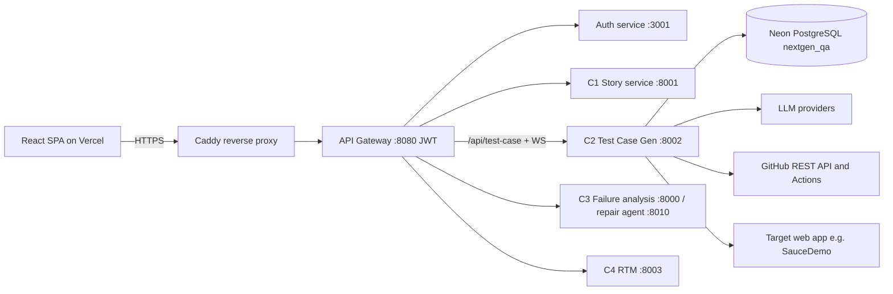
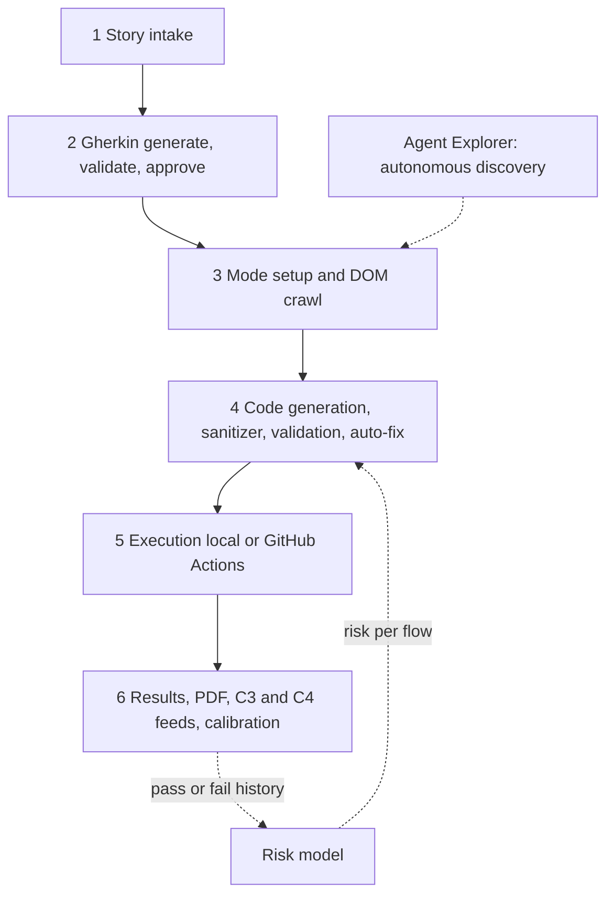
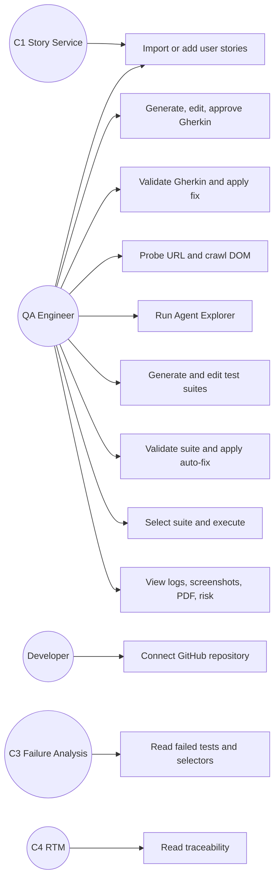
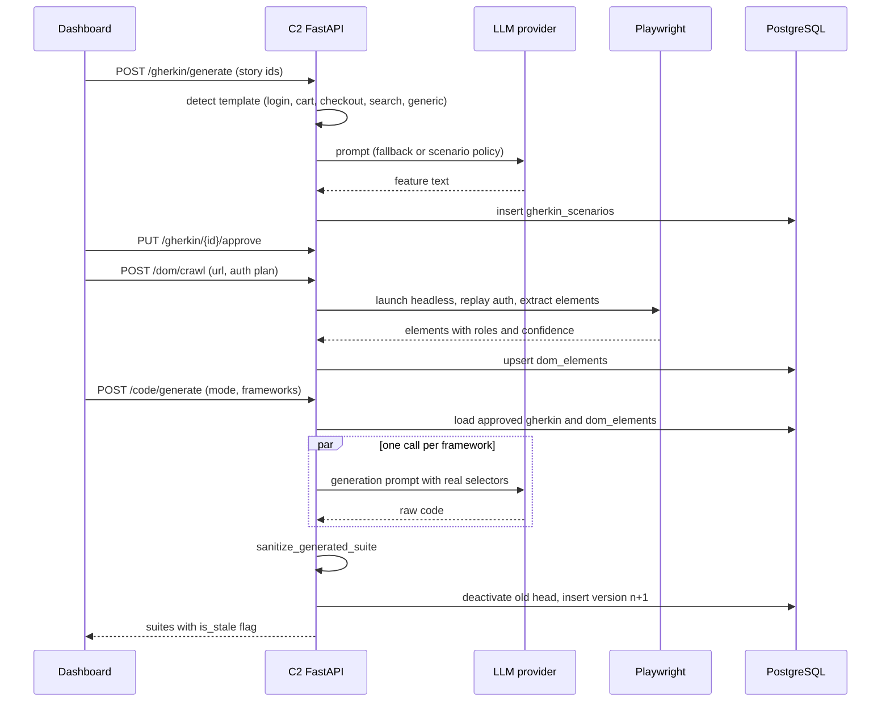
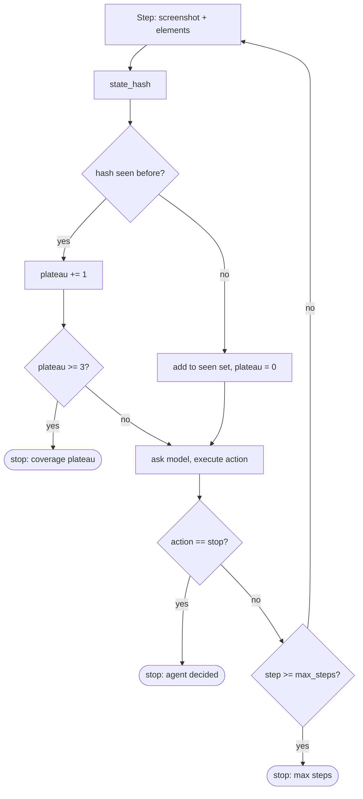
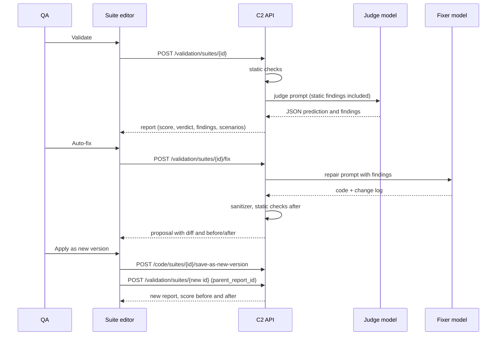
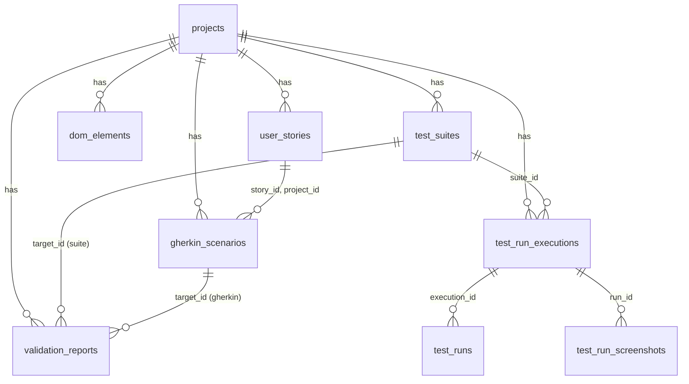

# NextGen QA: Intelligent Test Case Generation — Vision-Guided, DOM-Grounded Generation of Executable Test Suites from Agile User Stories with Independent Validation

**Component 2 of NextGen QA — An AI-Powered Closed-Loop QA Automation Platform**

**Project ID:** R26-SE-039
**Author:** Abeygunasekara D T — IT22303684
**Degree:** B.Sc. (Hons) in Information Technology, Specialising in Software Engineering
**Department:** Department of  Software Engineering
**Institution:** Sri Lanka Institute of Information Technology (SLIIT), Faculty of Computing
**Supervisor:** Ms. Suriyaa Kumari
**Co-Supervisor:** Mr. Eishan Weerasinghe
**Submission:** October 2026

> **Editing note (delete before submission):** text in `[square brackets]` is a placeholder for you to fill (dates, signatures, final figure numbers from your last evaluation run, survey results). Figures reference PNG files that already exist in the repository; the companion file `THESIS_FIGURES_AND_PROMPT.md` lists every one of them with its path.

---

## DECLARATION

I declare that this is my own work and this dissertation does not incorporate without acknowledgement any material previously submitted for a degree or diploma in any other university or institute of higher learning, and to the best of my knowledge and belief it does not contain any material previously published or written by another person except where the acknowledgement is made in the text.

Also, I hereby grant to Sri Lanka Institute of Information Technology the non-exclusive right to reproduce and distribute my dissertation, in whole or in part, in print, electronic or other medium. I retain the right to use this content in whole or part in future works (such as articles or books).

| Name | Student ID | Signature |
|---|---|---|
| Abeygunasekara D T | IT22303684 | [signature] |

The above candidate has carried out research for the bachelor's degree dissertation under my supervision.

Signature of the supervisor: ______________________ Date: [date]

Signature of the co-supervisor: ___________________ Date: [date]

---

## ABSTRACT

Agile teams capture requirements in sprint conversations faster than quality-assurance (QA) engineers can turn them into automated tests. Existing tooling solves single slices of this problem: record-and-playback tools produce brittle scripts tied to hard-coded locators, test-management tools store but do not generate test cases, and large-language-model (LLM) code generators produce plausible test code that is not grounded in the real user interface and offers no independent evidence of correctness. This dissertation presents Component 2 of NextGen QA, an intelligent test case generation engine that transforms structured user stories into human-readable Gherkin scenarios and executable multi-framework test suites (Playwright, Selenium, Cypress), grounds those suites in the live application through a headless DOM crawler, executes them locally or through GitHub Actions, prioritises execution with a machine-learning risk model, and, as its core research contribution, introduces two mechanisms that go beyond generation: (i) a vision-guided agentic explorer that autonomously discovers application behaviour using Set-of-Mark screenshot grounding, a four-role reasoning loop (planner, actor, observer, critic), reflexion memory and a coverage-plateau termination criterion; and (ii) an independent validation gate that combines deterministic static analysis with an LLM judge running on a model different from the generator, producing a per-scenario predicted pass rate, explainable findings with line references, and reviewable auto-fix proposals.

The artefact was built following Design Science Research, as a FastAPI/PostgreSQL micro-service with a React dashboard, integrated with the other three NextGen QA components through an API gateway and deployed on AWS with a test-gated CI/CD pipeline. Evaluation on the SauceDemo benchmark application over 65 CI/CD executions and 249 scenario runs showed a 72.7% pass rate for generated tests (login 81.9%, checkout 70.6%, cart 66.7%) and 100% story-to-Gherkin coverage. The validation gate detected a missing scenario implementation, vacuous tests and unverified selectors in the live suites and raised the deterministic score of a repaired suite while preserving the original version. The risk model achieved 94.25% accuracy on a synthetic bootstrap dataset, which is reported as a pipeline validation rather than a real-world result. The dissertation discusses the limitations of single-benchmark evaluation and LLM non-determinism and outlines the measurements required for publication: ablation of DOM grounding, fault-detection on seeded-defect accounts, APFD for risk ordering, validator calibration and a practitioner study.

**Keywords:** test case generation, large language models, Gherkin, behaviour-driven development, web agents, Set-of-Mark, LLM-as-a-judge, test validation, DOM grounding, CI/CD, test prioritisation

---

## ACKNOWLEDGEMENT

I would like to express my sincere gratitude to my supervisor, Ms. Suriyaa Kumari, and my co-supervisor, Mr. Eishan Weerasinghe, for their continuous guidance, critical feedback and encouragement throughout this research. Their insistence on measurable evidence and on independent validation of generated artefacts shaped the most important parts of this work.

I thank the research panel members whose comments at the progress presentations directed me towards the validation mechanism presented in Chapter 4, and the Faculty of Computing of SLIIT for the resources and the research environment.

I am grateful to my team members on NextGen QA (R26-SE-039), who own Components 1, 3 and 4, for the collaborative integration work on the shared gateway, authentication service and deployment, and for the many hours of joint debugging.

Finally, I thank my family and friends for their patience and support during this project.

---

## TABLE OF CONTENTS

- DECLARATION
- ABSTRACT
- ACKNOWLEDGEMENT
- TABLE OF CONTENTS
- LIST OF FIGURES
- LIST OF TABLES
- LIST OF ABBREVIATIONS
- 1. INTRODUCTION
  - 1.1 Background
  - 1.2 Literature Survey
    - 1.2.1 Requirements-to-Test and BDD Scenario Generation
    - 1.2.2 LLM-Based Test Code Generation
    - 1.2.3 GUI and Web Agents: Set-of-Mark, Multi-Role Reasoning and Reflexion
    - 1.2.4 Test Prioritisation and Risk Prediction
    - 1.2.5 Validation of LLM Output: Static Guards and LLM-as-a-Judge
  - 1.3 Research Gap
- 2. RESEARCH PROBLEM
- 3. RESEARCH OBJECTIVES
  - 3.1 Main Objective
  - 3.2 Sub Objectives
- 4. METHODOLOGY
  - 4.1 Requirement Gathering and Analysis
  - 4.2 Feasibility Study
  - 4.3 System Design
    - 4.3.1 Overall System Architecture
    - 4.3.2 Component 2 Pipeline Workflow
    - 4.3.3 Use Case Diagram
    - 4.3.4 Sequence Diagrams
  - 4.4 Technical Foundations
  - 4.5 Implementation Methodology
    - 4.5.1 User Story Intake and C1 Integration
    - 4.5.2 Gherkin Scenario Generator
    - 4.5.3 DOM Crawler and Element Map
    - 4.5.4 Dual-Mode Multi-Framework Code Generator
    - 4.5.5 Deterministic Sanitizer
    - 4.5.6 Vision-Guided Agent Explorer
    - 4.5.7 Execution Engine: Local Runner and GitHub Actions
    - 4.5.8 Independent Validation Gate
    - 4.5.9 LLM Auto-Fix Loop
    - 4.5.10 ML Risk Prediction
    - 4.5.11 Reporting, Traceability and Downstream Integration (C3, C4)
  - 4.6 Commercialisation Aspects
  - 4.7 System Considerations
- 5. IMPLEMENTATION AND TESTING
  - 5.1 Implementation
    - 5.1.1 Project Structure
    - 5.1.2 Data Model and Startup Migration
    - 5.1.3 REST and WebSocket API
    - 5.1.4 Code Generation and Versioning Flow
    - 5.1.5 Validation Engine Internals
    - 5.1.6 GitHub Actions Runner and Workflow Installation
    - 5.1.7 Deployment and CI/CD Gate
  - 5.2 Testing
    - 5.2.1 Test Plan and Test Strategy
    - 5.2.2 Test Case Design
- 6. RESULTS AND DISCUSSION
  - 6.1 Results
  - 6.2 Research Findings
  - 6.3 Discussion
- 7. CONCLUSION
- 8. REFERENCES
- 9. APPENDICES

---

## LIST OF FIGURES

| Figure | Title |
|---|---|
| Figure 1.1 | Position of Component 2 in the NextGen QA pipeline |
| Figure 4.1 | NextGen QA deployment architecture (gateway, services, Neon, Caddy) |
| Figure 4.2 | Component 2 six-stage pipeline |
| Figure 4.3 | Use case diagram for Component 2 |
| Figure 4.4 | Sequence diagram: story to executable suite |
| Figure 4.5 | Sequence diagram: one agent-explorer iteration |
| Figure 4.6 | Coverage-plateau termination flow |
| Figure 4.7 | Sequence diagram: validate, auto-fix, re-validate |
| Figure 4.8 | Validation score composition |
| Figure 5.1 | Entity relationship diagram of the Component 2 schema |
| Figure 5.2 | Suite version chain and validation report linkage |
| Figure 6.1 | Coverage funnel: stories to passing runs (`coverage_funnel.png`) |
| Figure 6.2 | Test-run outcomes (`run_outcomes.png`) |
| Figure 6.3 | Pass rate by flow (`pass_rate_by_flow.png`) |
| Figure 6.4 | Risk model confusion matrix (`confusion_matrix.png`) |
| Figure 6.5 | Risk model per-class metrics (`per_class_metrics.png`) |
| Figure 6.6 | Risk model feature importance (`feature_importance.png`) |
| Figure 6.7 | Training-set class distribution (`class_distribution.png`) |
| Figure 6.8 | Validation panel in the suite editor (screenshot) |
| Figure 6.9 | Auto-fix diff dialog (screenshot) |
| Figure 6.10 | Agent Explorer live view with Set-of-Mark overlay (screenshot) |

## LIST OF TABLES

| Table | Title |
|---|---|
| Table 1.1 | Comparison of existing approaches against the identified gap |
| Table 3.1 | Sub-objectives mapped to modules and evaluation metrics |
| Table 4.1 | Functional requirements |
| Table 4.2 | Non-functional requirements |
| Table 4.3 | Generation modes |
| Table 4.4 | Technology stack |
| Table 4.5 | Deterministic checks for test suites |
| Table 4.6 | Deterministic checks for Gherkin |
| Table 4.7 | Validation score rules |
| Table 4.8 | Risk model feature schema |
| Table 5.1 | Backend package structure |
| Table 5.2 | Database tables |
| Table 5.3 | REST endpoints |
| Table 5.4 | Test strategy by level |
| Table 5.5 | Representative test cases |
| Table 6.1 | Generation-quality metrics (live database) |
| Table 6.2 | Pass rate by flow |
| Table 6.3 | Risk model metrics |
| Table 6.4 | Validation gate results on live suites |
| Table 6.5 | Targets versus achieved |

## LIST OF ABBREVIATIONS

| Abbreviation | Meaning |
|---|---|
| AC | Acceptance Criteria |
| API | Application Programming Interface |
| APFD | Average Percentage of Faults Detected |
| BDD | Behaviour-Driven Development |
| CI/CD | Continuous Integration / Continuous Delivery |
| CSS | Cascading Style Sheets |
| DOM | Document Object Model |
| DSR | Design Science Research |
| E2E | End-to-End |
| JWT | JSON Web Token |
| LLM | Large Language Model |
| MAE | Mean Absolute Error |
| ML | Machine Learning |
| NFR | Non-Functional Requirement |
| ORM | Object-Relational Mapping |
| PAT | Personal Access Token |
| QA | Quality Assurance |
| RF | Random Forest |
| RTM | Requirements Traceability Matrix |
| SMOTE | Synthetic Minority Over-sampling Technique |
| SoM | Set-of-Mark |
| SPA | Single-Page Application |
| UI | User Interface |
| UUID | Universally Unique Identifier |
| WS | WebSocket |

---

# 1. INTRODUCTION

## 1.1 Background

Software quality depends on testing, yet testing remains the slowest and most labour-intensive part of the delivery pipeline. Agile and continuous delivery have accelerated how often teams ship, but the activities between a requirement being spoken in a sprint meeting and a passing automated test being available have barely changed: a business analyst writes a story, a QA engineer derives test cases by hand, an automation engineer hand-codes scripts, failures are triaged manually, and traceability between requirements and tests is kept in spreadsheets. Each hand-off loses information and time, and the resulting scripts decay as soon as the user interface changes, because their locators are hard-coded.

NextGen QA (R26-SE-039) is a four-component research platform that addresses this fragmentation as one closed loop: Component 1 converts meeting speech into structured user stories; **Component 2 (this work)** converts those stories into Gherkin scenarios and executable, UI-grounded test suites and runs them; Component 3 classifies failures and self-heals broken locators; Component 4 maintains a live requirements traceability matrix and quality prediction. Figure 1.1 shows the position of Component 2.

```
Meeting / Speech ──C1──► User Stories ──C2──► Gherkin ──C2──► Executable Test Code
                                                                   │
                                      DOM Crawler / Agent Explorer ┘ (real selectors)
                                                                   ▼
                                   Execution (local Playwright or GitHub Actions)
                                                                   │
                          ┌────────────────────────────────────────┼──────────────────────┐
                          ▼                                        ▼                      ▼
                 C2 Risk Prediction                     C3 Failure Analysis         C4 Traceability
                 + Independent Validation               + Self-Healing              Matrix + Quality
```
*Figure 1.1 — Position of Component 2 in the NextGen QA pipeline.*

Two developments make this problem newly tractable. First, large language models can now write syntactically correct test code for common frameworks from natural-language descriptions. Second, multimodal models can interpret screenshots of a user interface, which enables agents that explore an application the way a human tester would. However, both capabilities come with a well-documented weakness: the output is plausible rather than verified. A generated test may reference a locator that does not exist, may skip the assertion that would make it meaningful, or may encode a wrong expectation. Without an independent check, the human reviewer is the only safeguard, which does not scale.

This dissertation therefore treats generation and validation as inseparable. Component 2 generates Gherkin and multi-framework test code grounded in the real DOM, explores the application autonomously to discover behaviour, executes the suites in CI/CD, and validates every generated artefact with a mechanism that does not depend on the generator: deterministic static analysis plus an LLM judge on a different model, with reviewable auto-repair.

## 1.2 Literature Survey

### 1.2.1 Requirements-to-Test and BDD Scenario Generation

Behaviour-Driven Development (BDD) emerged from North's work on test-driven development vocabulary and was popularised by Cucumber, whose Gherkin syntax (Given/When/Then) gives a structured, executable specification language that non-programmers can read [1], [2]. A line of research has attempted to derive Gherkin or similar scenarios from requirements text. Early systems relied on rule-based natural-language processing and templates to convert use cases into test scenarios; they were reliable on constrained phrasing but brittle on free text. Recent studies apply LLMs to generate BDD scenarios from user stories and acceptance criteria and report high readability but inconsistent coverage of negative paths and a tendency to produce steps that are not observable and therefore not automatable [3], [4]. A recurring recommendation is a hybrid: templates for frequent flows (authentication, cart, checkout) to guarantee structure and determinism, and an LLM for novel flows, with a human approval step before downstream use. Component 2 adopts this hybrid design and adds deterministic Gherkin checks (every scenario has an action and an observable outcome; every acceptance criterion maps to a scenario).

### 1.2.2 LLM-Based Test Code Generation

Test generation with LLMs has been studied most for unit tests. TestPilot generates JavaScript unit tests with an adaptive prompting loop that feeds compiler and runtime errors back into the model, improving the proportion of passing tests [5]. ChatUniTest applies a generation-validation-repair loop for Java unit tests and shows that validation and repair, not the first generation, drive quality [6]. CodaMosa combines search-based test generation with LLM suggestions to escape coverage plateaus [7]. Across these works two findings recur: (a) raw LLM output frequently fails to compile or passes trivially without asserting anything, and (b) a feedback loop that validates and repairs the output is necessary. For end-to-end UI tests the problem is harder because correctness depends on the application state and on locators that exist only in the running UI. Studies of LLM-generated Selenium and Playwright scripts report that hallucinated selectors are the dominant failure cause, and that grounding the prompt with real page structure substantially improves executability [8]. Commercial record-and-playback and "codegen" tools (Selenium IDE, Playwright codegen, Katalon) avoid hallucination by recording a human, but they generate nothing autonomously and inherit the brittleness of recorded locators. Component 2's dual-mode design (abstract placeholders versus DOM-grounded selectors) is built to measure exactly this grounding effect, and its validation gate implements the validate-and-repair loop for UI tests.

### 1.2.3 GUI and Web Agents: Set-of-Mark, Multi-Role Reasoning and Reflexion

Set-of-Mark prompting overlays numbered marks on interactable regions of a screenshot so that a vision-language model can refer to elements by number instead of by coordinates, which markedly improves grounding accuracy for GPT-4V-class models [9]. WebVoyager builds an end-to-end web agent on multimodal input and reports that screenshot-plus-marks outperforms text-only accessibility trees on realistic web tasks [10]. AppAgent demonstrates exploration-based learning of mobile applications in which an agent first explores the UI autonomously and documents elements before performing tasks [11]. Reflexion shows that verbal self-reflection stored in episodic memory and injected into subsequent prompts improves agent success without weight updates [12]. Multi-role or multi-agent prompting (planner, executor, critic) has been shown to reduce error propagation in long-horizon tasks [13]. These works target task completion, not test generation; none of them asks when exploration has covered enough of the application to stop, which is the central question for a tester. Component 2 transfers these techniques to test discovery and adds a coverage-plateau termination criterion based on hashing observed UI states.

### 1.2.4 Test Prioritisation and Risk Prediction

Regression test prioritisation orders tests so that faults are detected as early as possible; Rothermel et al. introduced the APFD metric that is now standard for evaluating such orderings [14], and Elbaum et al. extended it with cost and severity [15]. Machine-learning approaches predict failure probability or defect-proneness from historical execution data and code or requirement features [16]. Random forests [17] are a common choice because they are robust on small tabular datasets and provide feature importance; SMOTE [18] is used to balance minority risk classes. The known weakness of ML prioritisation in new projects is the cold start: no execution history exists on day one. Component 2 bootstraps its RandomForest risk model on synthetic data generated from documented priors and reports that fact explicitly, treating APFD on real seeded faults as the defensible claim rather than classifier accuracy.

### 1.2.5 Validation of LLM Output: Static Guards and LLM-as-a-Judge

Because LLM output cannot be trusted by construction, two families of validation have emerged. The first is deterministic post-generation checking: parsing, compilation, linting and domain-specific pattern detection, as used in TestPilot's error feedback and in guardrail frameworks. The second is "LLM-as-a-judge", where a second model grades the output against a rubric; Zheng et al. show that strong models agree with human raters at a level comparable to inter-human agreement on open-ended tasks, but also document position bias, verbosity bias and self-enhancement bias, where a model prefers its own output [19]. The practical implications are that the judge should be a different model from the generator, should receive a fixed rubric with severity definitions, and should be complemented by deterministic checks whose verdicts do not depend on any model. Work on code review automation adds that findings must be anchored to line numbers and must be actionable to be adopted by developers [20]. Component 2's validation gate follows these recommendations: static checks run first, the judge is pinned to a different model via configuration, the rubric defines severities, findings carry line numbers and suggestions, and the final score is an explainable combination with documented caps.

### Summary comparison

*Table 1.1 — Comparison of existing approaches against the identified gap.*

| Capability | Record & playback / codegen | Test-management tools | Plain LLM generation | Web agents (WebVoyager, AppAgent) | Component 2 |
|---|---|---|---|---|---|
| Generates from requirements | No | No | Yes | No | Yes (Gherkin + code) |
| Grounded in real UI | Yes (recorded) | n/a | No | Yes (for tasks) | Yes (crawl + agent) |
| Autonomous behaviour discovery | No | No | No | Partial | Yes, with coverage-plateau stop |
| Multi-framework output | No | n/a | Yes | No | Yes (Playwright, Selenium, Cypress) |
| Executes in CI/CD and persists results | Partial | Partial | No | No | Yes (local + GitHub Actions) |
| Independent validation of generated tests | n/a | No | No | No | Yes (static + independent LLM judge + auto-fix) |
| Risk-based prioritisation | No | Partial | No | No | Yes (RF model, APFD planned) |
| Requirement traceability | No | Manual | No | No | Yes (feeds C4 RTM) |

## 1.3 Research Gap

The survey shows that each ingredient exists in isolation, but no system takes a user story to a grounded, executable, independently validated test suite in one loop:

1. **Generation without grounding.** LLM test generators hallucinate locators because they never see the application; recorders see the application but cannot generate from requirements.
2. **Exploration without a stopping rule.** Web agents complete tasks but have no notion of "enough coverage" to decide when test discovery is complete.
3. **Validation that is either absent or self-referential.** Generated tests are accepted on the generator's word and the reviewer's time; where a model grades the output it is usually the same model, which the LLM-as-a-judge literature warns against.
4. **No measurement loop.** Generated suites are rarely executed at scale with the results persisted, so predicted quality is never compared with actual outcomes.

Component 2 addresses all four: DOM-grounded dual-mode generation, a coverage-driven agentic explorer, an independent validation gate with explainable scoring and reviewable repairs, and a CI/CD execution path that stores per-scenario results for calibration and for the downstream components.

---

# 2. RESEARCH PROBLEM

The problem addressed by this component can be stated as follows:

> **How can executable UI test suites be generated automatically from Agile user stories such that they are grounded in the real application, discoverable beyond what the stories state, and independently validated before execution, within a closed CI/CD loop?**

This decomposes into four research questions:

- **RQ1 (Grounding).** Does grounding LLM generation in crawled DOM selectors (Mode B) improve the executability and pass rate of generated UI tests compared with ungrounded generation (Mode A and naive prompting)?
- **RQ2 (Discovery).** Can a vision-guided agent with Set-of-Mark grounding, multi-role reasoning and reflexion memory discover application behaviour and test scenarios autonomously, and can a novel-state-plateau criterion bound that exploration without losing coverage?
- **RQ3 (Validation).** Can a combination of deterministic static analysis and an independent LLM judge predict, per scenario, whether a generated test will pass, surface the concrete defects, and repair them, in a way that is explainable to a QA engineer and measurable against real execution results?
- **RQ4 (Prioritisation and integration).** Can risk-ordered execution and persisted per-scenario results make the generated suites useful to downstream failure analysis and traceability, and what evidence is required to defend a risk model bootstrapped without historical data?

The practical constraints are those of a four-component student research system: a single shared deployment, pluggable LLM providers with cost limits, one primary benchmark application (SauceDemo) with built-in seeded-defect accounts, and human-in-the-loop approval at each stage.

---

# 3. RESEARCH OBJECTIVES

## 3.1 Main Objective

To design, implement and evaluate an intelligent test case generation engine that converts structured user stories into independently validated, executable, multi-framework UI test suites grounded in the live application, and that closes the loop from requirement to CI/CD result within the NextGen QA platform.

## 3.2 Sub Objectives

*Table 3.1 — Sub-objectives mapped to modules and evaluation metrics.*

| # | Sub-objective | Module | Primary metric |
|---|---|---|---|
| SO1 | Generate human-readable, editable Gherkin from user stories with a template-first, LLM-fallback strategy and QA approval | `gherkin/` | Story-to-Gherkin coverage; AC traceability; practitioner rating |
| SO2 | Crawl a live application to build a semantic element map (role, selector, confidence) with authentication handling | `dom_crawler/` | Selector accuracy vs. manual ground truth |
| SO3 | Generate executable suites for Playwright, Selenium and Cypress in two modes (abstract, DOM-aware) with deterministic post-processing | `code_gen/` | Executability and pass rate per mode and framework |
| SO4 | Build a vision-guided agent that explores the application, discovers scenarios and terminates on coverage plateau | `agent_explorer/` | Unique UI states vs. baseline crawler; steps to plateau |
| SO5 | Execute suites locally or through GitHub Actions with live logs, screenshots, PDF reports and per-scenario persistence | `execution/`, `github_connection/` | End-to-end time; executions logged |
| SO6 | Validate every generated artefact independently (static checks + LLM judge on a different model), score it explainably and offer reviewable auto-fix | `validation/` | Findings precision; calibration (predicted vs. actual pass rate); score before/after fix |
| SO7 | Prioritise execution with an ML risk model and expose risk per flow | `ml/` | Classification report; APFD (planned) |
| SO8 | Integrate with C1 (story import), C3 (failed tests, selectors) and C4 (traceability) through the shared gateway, deploy with a test-gated CI/CD pipeline | `integration/`, deployment | Integration endpoints live; deploy gate passing |

---

# 4. METHODOLOGY

The work followed Design Science Research (DSR) as described by Hevner et al. [21] and the process model of Peffers et al. [22]: problem identification (Chapters 1 and 2), objectives (Chapter 3), design and development of the artefact (this chapter and Chapter 5), demonstration on SauceDemo, evaluation (Chapter 6) and communication (this dissertation and the team paper). Two design cycles were completed: Phase 1 targeted SauceDemo with fixed flows; Phase 2 generalised to any URL, added the agent explorer, the versioned suite editor, CI/CD execution and, after panel feedback, the independent validation gate.

## 4.1 Requirement Gathering and Analysis

Requirements were gathered from three sources: (a) the NextGen QA problem analysis and the interfaces agreed with the owners of Components 1, 3 and 4; (b) a review of QA practice in Agile teams and of the tools QA engineers currently use; and (c) supervisor and panel feedback across the proposal, progress and final presentations. The resulting functional and non-functional requirements are summarised in Tables 4.1 and 4.2.

*Table 4.1 — Functional requirements.*

| ID | Requirement |
|---|---|
| FR1 | Import user stories from Component 1 for the active project and iteration; allow manual entry and bulk upsert |
| FR2 | Generate a Gherkin feature per story; allow QA to edit, regenerate and approve; only approved Gherkin feeds code generation |
| FR3 | Probe a target URL and crawl its DOM into an element map with semantic roles, confidence and QA editing |
| FR4 | Generate test suites per selected framework in abstract or DOM-aware mode; store each generation as a new version; detect staleness when inputs change |
| FR5 | Allow QA to edit code in a Monaco editor, save, branch to a new version, restore history and select one suite for execution |
| FR6 | Execute the selected suite locally or through GitHub Actions; stream logs over WebSocket; capture screenshots; persist per-scenario results; produce a PDF report; support re-run |
| FR7 | Connect a GitHub repository with an encrypted PAT; install the workflow file automatically |
| FR8 | Run an autonomous exploration from a one-sentence intent; stream the agent's reasoning, actions, discovered scenarios and coverage |
| FR9 | Validate a Gherkin set or a test suite independently; show predicted pass rate, per-scenario prediction, findings with line references and the score breakdown |
| FR10 | Propose an LLM repair for selected findings; show a diff; apply as a new version and re-validate with linkage to the previous report |
| FR11 | Predict a risk level per flow and show it in the Code Review page |
| FR12 | Expose failed tests and selectors to Component 3 and traceability to Component 4 |

*Table 4.2 — Non-functional requirements.*

| ID | Requirement |
|---|---|
| NFR1 | Security: JWT enforced at the gateway; HTTPS only; PATs encrypted at rest (Fernet); secrets outside git and images |
| NFR2 | Independence of validation: the judge must be configurable to a different provider or model from the generator; deterministic checks must run without any model |
| NFR3 | Performance: Gherkin generation under 10 s per story; code generation for three frameworks in parallel; validation under 20 s per suite |
| NFR4 | Reliability: health endpoints; a failing test suite must block deployment; long-running work must not block request handling |
| NFR5 | Maintainability: one module per pipeline stage; API documented with OpenAPI; schema changes through idempotent startup migration |
| NFR6 | Portability: containerised; LLM provider pluggable (Anthropic, OpenAI, Gemini, Ollama) |
| NFR7 | Traceability: every suite records the hash and ids of the scenarios it was generated from; every validation report records the hash of the text it validated |

## 4.2 Feasibility Study

**Technical feasibility.** Playwright provides a stable headless browser for both crawling and execution and native screenshot capture; FastAPI provides async request handling and WebSockets; scikit-learn is sufficient for the tabular risk model; GitHub Actions removes the need for a self-managed CI server. The multimodal reasoning required by the agent explorer is available from commercial APIs (GPT-4o, Claude Sonnet). A proof of concept of story to Playwright code against SauceDemo was completed in the first sprint, which confirmed feasibility of the core path.

**Economic feasibility.** All infrastructure used free or student tiers: GitHub Actions minutes, a Neon PostgreSQL free tier, an AWS EC2 t3.medium instance on credits, DuckDNS for the domain and Let's Encrypt certificates through Caddy. LLM usage is the only variable cost; it was contained by using a small model (gpt-4o-mini) for high-volume Gherkin and code generation and reserving larger models (gpt-4o, Claude Sonnet) for the vision agent and the validator.

**Operational feasibility.** QA engineers already review test cases and code; the dashboard keeps them in that role (approve Gherkin, review code, approve a fix) rather than requiring new skills. SauceDemo is a public, stable benchmark used widely in automation training and research and offers seeded-defect user accounts, which makes controlled fault-detection experiments possible without building a faulty application.

**Schedule feasibility.** The repository history spans April 2026 to October 2026 across eight sprints: foundation and dashboard (April), persistence and project scoping (April), DOM crawler and dual-mode generation (May), risk model and agent explorer (May), versioned suites and GitHub execution (June), live preview and re-run (June), shared-gateway integration and Neon migration (July to August), AWS deployment and CI gate (August), and the validation gate (October).

## 4.3 System Design

### 4.3.1 Overall System Architecture

NextGen QA is deployed as micro-services behind a single API gateway (Figure 4.1). The browser talks only to the gateway; the gateway verifies JWTs issued by the authentication service and forwards requests by prefix (`/api/test-case` to Component 2 on port 8002, with WebSocket pass-through). Each service owns a database on Neon; the authentication service is the system of record for organisations, projects and iterations, and other services store only reference UUIDs. Component 2 therefore accepts a client-supplied project UUID so that its project rows share identity with the platform project.


*Figure 4.1 — NextGen QA deployment architecture.*

### 4.3.2 Component 2 Pipeline Workflow

Component 2 is organised as six stages, each a backend package and a dashboard screen (Figure 4.2):

1. **User Story Intake** — import from C1 or manual entry.
2. **Gherkin Generation and Approval** — template-first with LLM fallback; QA edits and approves; independent validation available.
3. **Mode Setup and DOM Inspection** — choose abstract or DOM-aware mode, frameworks and target URL; probe and crawl; edit and approve the element map. The Agent Explorer sits alongside this stage as the autonomous discovery path.
4. **Code Generation and Review** — one LLM call per framework in parallel; sanitizer; versioned suites; stale detection; independent validation and auto-fix; risk badges.
5. **Execution** — local Playwright runner or GitHub Actions; live logs; screenshots; PDF; per-scenario persistence.
6. **Downstream** — failed tests and selectors to C3; traceability to C4; execution results feed validator calibration and the risk model.


*Figure 4.2 — Component 2 six-stage pipeline.*

### 4.3.3 Use Case Diagram


*Figure 4.3 — Use case diagram for Component 2.*

### 4.3.4 Sequence Diagrams

**Story to executable suite (Figure 4.4).** The dashboard requests Gherkin generation; the backend selects a template by keyword detection or falls back to the LLM, stores the feature and returns it. After approval, the Mode Setup page probes the URL; the crawler logs in if needed, extracts interactive elements with inferred roles and stores them. Code generation loads approved Gherkin and the element map for the URL, fans out one LLM call per framework, sanitises each result, deactivates the previous head of each framework chain and inserts a new version with the combined hash of its inputs.


*Figure 4.4 — Sequence diagram: story to executable suite.*

**One agent-explorer iteration (Figure 4.5)** and **coverage-plateau termination (Figure 4.6)** are described with the agent in Section 4.5.6. **Validate, auto-fix and re-validate (Figure 4.7)** is described in Sections 4.5.8 and 4.5.9.

## 4.4 Technical Foundations

*Table 4.4 — Technology stack.*

| Layer | Technology | Role |
|---|---|---|
| Backend | Python 3.10+, FastAPI, Uvicorn, SQLAlchemy 2 (async), asyncpg | REST and WebSocket API, ORM |
| Browser automation | Playwright (Chromium) | DOM crawler, agent explorer, local test runner, screenshots |
| Generation | Jinja2 templates; HTTP clients to Anthropic Messages API, OpenAI Chat Completions, Google Gemini, Ollama | Gherkin and code generation; judge and fixer |
| Validation | Python `ast`, custom JS bracket scanner, `node --check` when available, `difflib` | Deterministic checks |
| ML | scikit-learn RandomForest, imbalanced-learn SMOTE, joblib | Risk model |
| Execution | pytest, pytest-playwright, Selenium, Cypress, allure-pytest, GitHub Actions REST API | Running generated suites |
| Reporting | ReportLab | PDF reports |
| Security | cryptography (Fernet) | Encrypted PAT storage |
| Frontend | React 19, Vite, Tailwind CSS 4, react-router 7, zustand, Monaco Editor (editor and DiffEditor), lucide-react | Dashboard |
| Data | PostgreSQL 15 on Neon (JSONB for findings, artefacts, element attributes) | Persistence |
| Deployment | Docker, Docker Compose, Caddy (auto-HTTPS), AWS EC2 (ap-southeast-1), DuckDNS, GitHub Actions self-hosted runner, Vercel | Hosting and CI/CD |
| Testing | pytest, FastAPI TestClient | Unit and integration tests |

Key techniques used across modules:

- **Set-of-Mark prompting** [9]: a JavaScript snippet injected into the page draws numbered boxes over interactable elements and returns their selectors and bounding boxes; the screenshot and the numbered list are sent together to the vision model.
- **Multi-role reasoning in one call** [13]: the prompt asks for four tagged thoughts (planner, actor, observer, critic) and one action in a single JSON response, which gives the structure of a multi-agent loop without four times the token cost.
- **Reflexion memory** [12]: lessons emitted by the critic after failed actions are appended to a list and injected into subsequent prompts.
- **State hashing**: SHA-1 of the URL plus the sorted element fingerprints identifies a UI state; novelty is set membership.
- **Content hashing for traceability**: suites store the SHA-256 of their scenario ids and DOM inputs; validation reports store the SHA-256 of the validated text; the UI derives "stale" and "outdated" flags from hash comparison instead of timestamps.
- **LLM-as-a-judge with independence** [19]: judge provider and model are read from `VALIDATOR_*` environment variables and fall back to the generator's settings only if unset; the report records which model judged and whether it differed from the generator.

## 4.5 Implementation Methodology

### 4.5.1 User Story Intake and C1 Integration

Stories are scoped to a project and optionally to an iteration. The merged dashboard's "Import from Meetings" fetches approved stories from Component 1 through the gateway, maps MoSCoW priorities to high/medium/low and "As a / I want / so that" into actor, action and goal, and bulk-upserts them into Component 2 keeping the C1 UUID as the story id, so repeated imports are idempotent and traceability back to the meeting is preserved. Manual entry and acceptance criteria (stored as a JSON array) are supported for projects without Component 1.

### 4.5.2 Gherkin Scenario Generator

The generator is template-first. A keyword detector classifies the story into login, cart, checkout, search or generic and renders the matching Jinja2 template with the story fields and acceptance criteria. When an LLM provider is configured, `generate_with_llm` produces the feature instead, under a scenario policy ("lean" keeps the happy path and the principal negative path; "full" keeps all). SauceDemo-specific stabilisers normalise known pitfalls (the exact invalid-login error text, the empty-cart badge behaviour and the two-step checkout) so that generated Gherkin states observable outcomes. Each feature is stored with its generator (`jinja2` or `llm`), the model used, and flags for QA edits and approval. Only approved features reach code generation.

### 4.5.3 DOM Crawler and Element Map

`probe_url` checks reachability and detects whether the page requires authentication. `crawl_url` launches headless Chromium, replays an authentication plan when one is provided (background credentials, manual steps or a stored storage state), waits for network idle and extracts interactive elements (inputs, buttons, links, selects, textareas) with tag, text, attributes and a stable CSS selector. `_infer_role` assigns a semantic role (for example `password_input`, `login_button`, `add_backpack`) with a confidence score from tag, type and attribute heuristics. Elements are stored per project and URL; QA can edit roles and selectors, add missing elements and approve them. Live crawl logs stream over WebSocket.

### 4.5.4 Dual-Mode Multi-Framework Code Generator

*Table 4.3 — Generation modes.*

| | Mode A — Abstract | Mode B — DOM-aware |
|---|---|---|
| Inputs | Approved Gherkin | Approved Gherkin + crawled element map for the URL |
| Locators | `<<USERNAME_INPUT_PLACEHOLDER>>` style placeholders | Exact crawled selectors; a TODO comment when a step needs an element that was not crawled |
| Runnable immediately | No | Yes |
| Use | No staging access; portability demonstration | Live staging; the demonstrated path |

The prompt is assembled from framework instructions (Python/pytest/Playwright, Python/pytest/Selenium, JavaScript/Cypress), runtime constraints (headless only), target-application knowledge for SauceDemo (URL after login, exact error strings, toggling add-to-cart buttons, two-step checkout, reference helper implementations), test design rules (no test calls another test, helpers for shared steps, a fresh page per test, robust selectors) and strict scope rules (implement only the listed scenario titles). All selected frameworks are generated concurrently with `asyncio.gather`, so wall-clock time is the slowest call rather than the sum. Markdown fences are stripped and the result is sanitised.

Suites are versioned per (project, framework). Generation or "save as new version" deactivates the current head and inserts version n+1; history is kept and any version can be restored as a new head. Each suite stores the combined hash of its scenario ids and DOM inputs; the list endpoint compares it with the current hash to flag stale suites.

### 4.5.5 Deterministic Sanitizer

Prompt guidance is probabilistic; the sanitizer is not. It runs after generation (and after every auto-fix) and mechanically repairs patterns that LLMs reintroduce regardless of wording, such as clicking the same `#add-to-cart-*` selector twice (the button toggles to `#remove-*` after the first click, so the second click hangs until timeout). It only applies repairs that cannot change the meaning of otherwise-correct code and returns the list of applied fixes for logging and for the validation report.

### 4.5.6 Vision-Guided Agent Explorer

The agent turns a one-sentence intent ("check the login flow") into autonomous exploration. Each iteration (Figure 4.5): wait for the page to settle; inject the Set-of-Mark overlay and collect the element list; take a screenshot; compute the state hash and decide novelty; call the vision model with the intent, sub-goals done and pending, action history, reflexion lessons, the element list and the screenshot; parse the JSON response containing four role-tagged thoughts and one action (`click`, `fill`, `select`, `navigate`, `discover_scenario`, `complete_goal`, `stop`); execute the action with Playwright; record the step and any lesson; publish typed events to the per-run broker that the dashboard consumes over WebSocket (status, screenshot, thought, action, scenario_discovered, lesson, coverage, done, error).

```mermaid
sequenceDiagram
    autonumber
    participant Loop as Agent loop
    participant Page as Chromium
    participant VLM as Vision model
    participant UI as Dashboard (WS)
    Loop->>Page: inject SoM overlay, collect elements
    Loop->>Page: screenshot
    Loop->>Loop: state_hash, novel?
    Loop->>UI: screenshot event
    Loop->>VLM: intent + goals + history + lessons + elements + image
    VLM-->>Loop: JSON thoughts (planner, actor, observer, critic) + action
    Loop->>UI: four thought events
    Loop->>Page: execute action
    Loop->>UI: action event, scenario or coverage event
```
*Figure 4.5 — Sequence diagram: one agent-explorer iteration.*

**Termination** is the research contribution of this module (Figure 4.6). The loop stops when (a) the agent emits `stop`, (b) `max_steps` (default 12) is reached, or (c) `PLATEAU_LIMIT` consecutive steps (default 3) add no novel state. At the end, a synthesis call converts the discovered states and actions into Gherkin scenario drafts that the QA can approve into the normal pipeline.


*Figure 4.6 — Coverage-plateau termination flow.*

### 4.5.7 Execution Engine: Local Runner and GitHub Actions

`detect_mode` chooses GitHub execution when the project has a connected repository and credentials, otherwise the local runner. The **local runner** writes the selected suite into a temporary pytest project with an instrumented `conftest.py` that forces headless launch, snapshots a live frame after each action for the dashboard preview and takes a final screenshot per test; it parses the pytest summary into passed and failed counts and per-test status. The **GitHub runner** pushes the suite to a `runs/{uuid}` branch, dispatches the installed workflow, polls run progress, fetches the final log through the REST API and reads the per-scenario results. Both paths write one `test_run_executions` row per click and one `test_runs` row per scenario (with a derived `flow_name` used by the risk model), stream progress over WebSocket, store screenshots, and generate a PDF report. Re-run is supported for both modes.

The **GitHub connection** module validates a PAT, lists repositories, stores the PAT encrypted with Fernet under a persistent key, installs the workflow YAML into the repository on connect and can reinstall it; credentials are also exposed to Component 4 through an internal endpoint protected by a shared header key.

### 4.5.8 Independent Validation Gate

Panel feedback required "a mechanism to independently validate the generated test cases". Independence is achieved by combining checks whose correctness does not depend on the generator:

1. **Deterministic static checks** (Tables 4.5 and 4.6), pure functions of the artefact text, the element map and the source Gherkin, unit-tested without network access.
2. **An LLM judge** that did not author the artefact, pinned to a different model through configuration, given the line-numbered artefact, the Gherkin, the element map marked explicitly as partial, known facts about the target application, and the static findings already discovered so it does not repeat them. It returns strict JSON: a holistic pass probability, per-scenario `pass | fail | uncertain` with confidence and reason, findings with severity, category, line, snippet, suggestion and a `fixable` flag, and strengths. For Gherkin it also returns semantic acceptance-criteria coverage. The prompt defines the severity scale (critical: the file will not collect or one root cause fails most tests; major: one test fails or is vacuous; minor: fragile or unverified; info: observation).
3. **Execution calibration**: each suite's latest report is joined with its latest finished execution to compare predicted and actual pass rate and compute the mean absolute error.
4. **Human review**: findings, predictions and diffs are shown before approval; nothing is applied automatically.

*Table 4.5 — Deterministic checks for test suites.*

| Check | Severity | Rationale |
|---|---|---|
| Python `ast.parse`; JavaScript bracket and string scanner, `node --check` | critical | The file will not be collected; every test fails |
| No `test_*` or `it(...)` found | critical | Runner collects zero tests |
| Unresolved `<<PLACEHOLDER>>` in DOM-aware mode (info in abstract mode) | critical | Not a valid selector |
| Test with no assertion (direct, `expect`, `.should`, explicit wait, or via a helper that asserts, resolved transitively) | major | Vacuous: cannot fail on a defect |
| Empty test body | major | Passes trivially |
| Test calls another test | major | Fixtures are not injected; raises `TypeError` |
| Gherkin scenario with no implementing test (title match on name, docstring, body) | major | Requirement silently dropped |
| Headed browser forced | major | Crashes on CI without a display |
| Known fatal anti-pattern (sanitizer dry-run) | major | Hangs until timeout |
| Selectors not in the crawled element map (one grouped finding with nearest crawled candidates) | minor | Unverified: uncrawled page or invented |
| Long fixed sleeps, long `cy.wait`, leftover TODO | minor | Flakiness, incompleteness |

*Table 4.6 — Deterministic checks for Gherkin.*

| Check | Severity |
|---|---|
| Empty text; no scenarios; empty scenario | critical |
| Missing `Feature:`; scenario without `When`; scenario without `Then`; outline without `Examples`; placeholder without column | major |
| Missing `Given`; starts with And/But; duplicate titles; untitled; vague wording ("works correctly"); acceptance criterion not lexically covered | minor |

**Scoring** (Table 4.7, Figure 4.8) is deliberately simple and stored with each report so the dashboard can explain it.

*Table 4.7 — Validation score rules.*

| Term | Definition |
|---|---|
| static_score | 100 minus penalties (critical 25, major 10, minor 3), floored at 0 |
| llm_score | judge's pass probability (0 to 100) |
| scenario_rate | scenarios predicted to pass divided by scenarios judged, times 100 |
| base | 0.5 × llm_score + 0.3 × scenario_rate + 0.2 × static_score; static_score alone when no judge is available |
| caps | any static critical: at most 15; any judge critical: at most 40; any major: at most 85 |
| verdict | likely_failing if any critical or score < 50; ready if score ≥ 80 and no major; otherwise needs_review |

```
          ┌──────────────┐   0.5   ┌───────────┐
          │ LLM judge    ├────────►│           │  caps:
          │ pass prob.   │         │           │  static critical ≤ 15
          └──────────────┘   0.3   │   base    │  judge critical  ≤ 40   ──►  score, verdict
          ┌──────────────┐────────►│           │  any major       ≤ 85
          │ scenario rate│         │           │
          └──────────────┘   0.2   │           │
          ┌──────────────┐────────►└───────────┘
          │ static score │
          └──────────────┘
```
*Figure 4.8 — Validation score composition.*

Each `validation_reports` row stores target type and id, the content hash of the validated text, scores, verdict, findings, scenarios, breakdown (weights, caps applied, counts, whether the judge was available and independent), judge provider and model, duration and an optional parent report id. The dashboard marks a report as outdated when the stored hash no longer matches the current text.

### 4.5.9 LLM Auto-Fix Loop

The fixer receives the artefact, the selected findings (ids, lines, suggestions), the Gherkin, the element map (marked partial) and framework rules, and must return the minimally changed artefact between explicit markers followed by a JSON change log that maps each edit to a finding id. Marker delimiting rather than JSON encoding keeps large code bodies intact. The sanitizer runs on the result, and static checks run again to report a before-and-after deterministic score. The proposal is returned to the dashboard, which shows a side-by-side Monaco diff, the change log and the remaining findings. Applying creates a **new suite version** (or updates the Gherkin text) and triggers re-validation with `parent_report_id` set to the previous report, so the score movement is recorded (Figure 4.7). Findings marked not fixable (for example a TODO that needs an uncrawled selector) are excluded from the fixer's scope.


*Figure 4.7 — Sequence diagram: validate, auto-fix, re-validate.*

### 4.5.10 ML Risk Prediction

The risk model is a 3-class RandomForest (LOW, MEDIUM, HIGH) over an 18-feature schema defined once in `features.py` so training and inference cannot drift (Table 4.8). At inference the features are extracted from the live database per flow bucket (`login_flow`, `cart_ops`, `checkout`, `search`) and the prediction is shown in the Code Review page. Because no execution history exists on day one, the training set of 2,000 rows is synthesised from bucket-specific Gaussian priors with the label derived from `past_pass_rate` by thresholds and 5% label noise. The dataset script is designed to be replaced by a real-data extractor with the same CSV schema once enough `test_runs` accumulate. This provenance is stated wherever the model's accuracy is reported.

*Table 4.8 — Risk model feature schema.*

| Group | Features |
|---|---|
| Priority (one-hot) | priority_high, priority_medium, priority_low |
| Scenario shape | n_steps, has_auth, has_payment, has_form_input |
| DOM / UI | n_inputs, n_buttons, avg_dom_confidence |
| Authoring | qa_edit_ratio, n_assertions, n_waits, code_lines |
| Execution history | past_pass_rate, past_runs, mean_duration_s, duration_stddev_s |

### 4.5.11 Reporting, Traceability and Downstream Integration (C3, C4)

A PDF report is generated per execution with the summary, per-scenario outcomes and screenshots. Two read-only integration endpoints serve Component 3: failed and errored scenario rows shaped as its analysis input (test name, duration, heuristic failure type, extracted old locator, source and suite metadata), and the element map as locator-healing ground truth. Component 4 reads a traceability endpoint that links stories, Gherkin, active suites and their latest executions; a light mode skips code and logs to keep the RTM responsive. The validation summary endpoint exposes counts, average score and the predicted-versus-actual calibration for dashboards and for the evaluation.

## 4.6 Commercialisation Aspects

**Target market.** Software teams practising Agile with CI/CD: in-house QA teams, development agencies and SaaS companies, with a strong fit for regulated domains (finance, health) that must evidence requirement-to-test traceability and independent verification of test assets.

**Value proposition.** Compress the time from a spoken requirement to a passing, traceable, validated automated test from hours to minutes; reduce test-maintenance cost through DOM-grounded generation, an autonomous explorer that finds behaviour humans forget to specify, and self-healing downstream; and give QA leads an auditable validation record (who judged, what was found, what was fixed) for every generated test.

**Business model.** SaaS subscription per project or seat with a usage-based LLM tier; an on-premises option with a local model (the provider layer already supports Ollama) for enterprises that cannot send application screenshots to external APIs; professional services for onboarding target applications.

**Differentiators.** The closed loop (generate, validate, run, analyse, heal, trace) that point tools do not offer; LLM-agnostic design; and the validation gate, which answers the first objection every buyer raises about AI-generated tests: "how do I know they are right?"

**Go-to-market.** Start with teams already using Cucumber or Playwright, where Gherkin and the generated code slot into existing repositories through the GitHub integration; expand through the traceability and quality features of Components 3 and 4.

## 4.7 System Considerations

- **Security.** JWT enforced at the gateway on protected routes; HTTPS everywhere; PATs encrypted at rest with a persistent Fernet key; internal service calls guarded by a shared header key; secrets kept out of images and git; only the reverse proxy is public.
- **Privacy.** Screenshots and DOM content of the target application are sent to LLM providers; the provider is configurable and a local model path exists for sensitive deployments.
- **Ethics.** Generated tests and fixes are proposals; a human approves Gherkin, selects suites and applies repairs. Validation reports record the judging model to keep automated judgements auditable.
- **Reliability.** Long-running work (crawl, agent, execution, validation) runs off the request path with progress streamed; the deployment pipeline runs the test suite inside the image and refuses to deploy on failure; health probes feed a status page.
- **Scalability and portability.** Stateless services behind a gateway, managed PostgreSQL, containers; LLM calls are the main cost and are parallelised per framework.
- **Limitations by design.** UI tests only (API testing is well served by existing tools); the primary benchmark is SauceDemo; validator and generator share one API key budget.

---

# 5. IMPLEMENTATION AND TESTING

## 5.1 Implementation

### 5.1.1 Project Structure

*Table 5.1 — Backend package structure (`backend/app/`).*

| Package | Responsibility |
|---|---|
| `main.py` | FastAPI app, CORS, lifespan (startup migration), router registration, WebSocket registration |
| `database.py` | Async engine for Neon (SSL, pool pre-ping and recycle), `init_db` idempotent migration |
| `models.py` | ORM models: projects, user_stories, gherkin_scenarios, test_suites, dom_elements, test_runs, test_run_executions, test_run_screenshots, validation_reports |
| `routes.py` | Projects, stories, Gherkin, DOM, code suites (versioning), risk endpoints |
| `gherkin/` | Template detection, Jinja2 templates (login, cart, checkout, search, generic), LLM fallback, scenario policy |
| `dom_crawler/` | Probe, auth plan, crawler, role inference, log broker |
| `code_gen/` | Prompt assembly and provider calls; sanitizer |
| `agent_explorer/` | SoM overlay script, agent loop, event broker, routes and WebSocket |
| `execution/` | Mode detection, local runner, GitHub runner, PDF generator, routes and WebSocket |
| `github_connection/` | PAT crypto and store, workflow installer, routes |
| `validation/` | Findings model, static checks, LLM client, judge, fixer, service (scoring, persistence, calibration), routes |
| `ml/` | Feature schema, synthetic dataset, training, prediction, report scripts and charts |
| `integration/` | Read-only endpoints for C3 |

The dashboard lives in the merged team frontend under two modules owned by this component: Test Case Gen (`/test-case/*`: stories, Gherkin editor, agent explorer) and Test Script Gen (`/test-script/*`: mode setup, DOM inspector, code review, suite editor, execution, GitHub settings), sharing one API module, one types file and a components folder that includes the validation panel, the fix dialog and the score ring.

### 5.1.2 Data Model and Startup Migration

*Table 5.2 — Database tables.*

| Table | Purpose | Key columns |
|---|---|---|
| projects | Workspace; id shared with the platform project | organization_id |
| user_stories | Stories per project (composite key with project) | actor, action, goal, priority, status, source, acceptance_criteria, iteration_id |
| gherkin_scenarios | Feature text per story | generator, llm_model, edited_by_qa, approved |
| dom_elements | Crawled element map per URL | selector, tag, text, attributes (JSONB), role, confidence, approved |
| test_suites | Versioned generated code per framework | mode, url, source_scenarios_hash, source_scenario_ids (JSONB), version, is_active, selected_for_run |
| test_run_executions | One row per execution | mode (github or local), status, github_run_id/url/branch, counts, raw_log_text, artifacts_json, pdf_path |
| test_runs | One row per scenario per execution | scenario_name, flow_name, status, duration_ms, error_message, execution_id |
| test_run_screenshots | Screenshot index per scenario | filename, status |
| validation_reports | Independent validation passes | target_type, target_id, content_hash, score, verdict, static_score, llm_score, scenario_total, scenario_pass_predicted, findings/scenarios/breakdown (JSONB), validator_provider/model, parent_report_id |


*Figure 5.1 — Entity relationship diagram of the Component 2 schema.*

Schema evolution is handled by an idempotent startup migration: `create_all` creates missing tables, then a sequence of `ADD COLUMN IF NOT EXISTS`, index and data-repair statements patches legacy databases; no migration tool is required and a fresh Neon database boots in one step.

### 5.1.3 REST and WebSocket API

*Table 5.3 — REST endpoints (all under `/api/v1`).*

| Group | Endpoints |
|---|---|
| Projects and stories | `POST/GET/DELETE /projects`, `GET/POST /projects/{id}/stories`, `POST .../stories/bulk`, `DELETE .../stories/{sid}` |
| Gherkin | `POST /gherkin/generate`, `GET /gherkin/{pid}/{sid}`, `PUT /gherkin/{id}`, `PUT /gherkin/{id}/approve`, `POST /gherkin/{pid}/{sid}/regenerate` |
| DOM | `POST /dom/probe`, `POST /dom/crawl`, `GET/POST /dom/elements`, `PUT/DELETE /dom/elements/{id}`, `POST /dom/elements/bulk-approve` |
| Code suites | `POST /code/generate`, `GET /code/suites`, `GET /code/suites/{id}`, `GET .../history`, `PUT /code/suites/{id}`, `POST .../save-as-new-version`, `POST .../restore`, `POST .../select-for-run` |
| Execution | `POST /execute`, `POST /runs/{id}/rerun`, `GET /runs`, `GET /runs/{id}`, `GET .../log`, `GET .../report.pdf`, `GET .../screenshots/{file}`, `POST /webhooks/github-runs` |
| GitHub | validate token, get/connect/disconnect connection, reinstall workflow, ping |
| Agent | `POST /agent/explore` |
| Validation | `POST/GET /validation/suites/{id}`, `POST /validation/suites/{id}/fix`, `POST/GET /validation/gherkin/{id}`, `POST /validation/gherkin/{id}/fix`, `GET /validation/projects/{id}/latest`, `GET /validation/projects/{id}/summary`, `GET /validation/reports/{id}` |
| Risk and integration | `GET /projects/{id}/risk`, `GET /projects/{id}/failed-tests`, `GET /projects/{id}/selectors`, `GET /projects/{id}/traceability` |

WebSocket channels stream crawl logs, execution events (log line, status, screenshot frame, finished) and agent events. OpenAPI documentation is served at `/docs` and publicly at `/testcase-docs/docs` on the deployment.

### 5.1.4 Code Generation and Versioning Flow

`POST /code/generate` loads approved Gherkin, computes the scenario fingerprint, loads the element map for the URL in DOM mode, computes the combined input hash, fans out generation per framework, sanitises, deactivates the previous active suite per framework and inserts the new version. The list endpoint recomputes the current combined hash and marks each suite `is_stale` when it differs from the stored one. Editing autosaves into the active head; "save as new version" and "restore" create a new head from the editor text or from a historical row; "select for run" marks exactly one suite per project (Figure 5.2).

```
test_suites (framework = playwright)
 v26 (inactive) ── v27 (inactive) ── v28 (active, selected_for_run)
                                      │
                                      ├── validation_reports r1 (score 40)
                                      └── auto-fix → v29 (active) ── validation_reports r2 (parent r1, score after fix)
```
*Figure 5.2 — Suite version chain and validation report linkage.*

### 5.1.5 Validation Engine Internals

`static_checks.py` contains a small Gherkin parser (feature, background, scenarios, steps, examples), test extraction for Python (via `ast`, including end lines and docstrings) and for JavaScript (string-aware brace matching), selector extraction for Playwright, Selenium `By.*` and Cypress `cy.get` plus a quote-safe CSS literal pattern, grounding of selectors against the element map by exact selector, id, data-test attributes and classes, and helper-aware assertion detection that propagates through helper-calls-helper chains. `judge.py` and `fixer.py` build the prompts described in Sections 4.5.8 and 4.5.9 and normalise the responses (severity clamping, line-range validation, length limits). `service.py` loads the context of a suite (the Gherkin it was generated from, falling back to approved Gherkin, and the element map), orchestrates checks and judge, tolerates judge failure by falling back to a static-only score with an informational finding, computes the score and persists the report. The judge model is resolved from `VALIDATOR_PROVIDER`, `VALIDATOR_MODEL` and `VALIDATOR_API_KEY`, falling back to the generator's settings; in the evaluated configuration the generator was gpt-4o-mini and the validator gpt-4o.

### 5.1.6 GitHub Actions Runner and Workflow Installation

On connection, the backend writes a workflow file into the repository through the Contents API. The workflow is dispatched with the run branch and inputs, installs Python, Playwright and the browser, runs pytest with Allure results and screenshot capture, uploads artefacts and reports completion. The backend polls the run, streams status to the dashboard, fetches the final log and parses per-test outcomes. The run branch per execution isolates generated code from the team's main branch.

### 5.1.7 Deployment and CI/CD Gate

The service is containerised (Python slim image with Chromium and Playwright dependencies) and runs under Docker Compose on an EC2 instance behind Caddy with automatic HTTPS and a DuckDNS domain. A self-hosted GitHub Actions runner on the instance deploys on push to the deployment branch: checkout, rsync (excluding `.env`), build the image, run the test suite inside the built image, and only then restart the service. Tests are not baked into the production image. The same workflow pattern is used by the other components.

## 5.2 Testing

### 5.2.1 Test Plan and Test Strategy

*Table 5.4 — Test strategy by level.*

| Level | Scope | Tooling | Gate |
|---|---|---|---|
| Unit | Sanitizer rules; Gherkin parser; every static validation rule; selector extraction and grounding; scoring and caps | pytest, no network or database | Runs in CI inside the image; blocks deploy |
| Integration | App boots with all routers; root, health, OpenAPI, docs endpoints; validation routes registered | FastAPI TestClient without lifespan (hermetic) | Blocks deploy |
| API (live) | Validation routes exercised over HTTP against the live database: latest reports, summary with calibration, Gherkin validation, fix with unknown finding ids, invalid ids | Uvicorn on a spare port + httpx | Manual before merge |
| System | End-to-end: import story, generate Gherkin, crawl, generate suite, validate, auto-fix, execute locally and via GitHub, PDF | Dashboard against SauceDemo | Demo rehearsal |
| Evaluation | Generation-quality script over the live database; risk-model training report; validation smoke on stored suites | `generation_eval.py`, `train.py`, `make_charts.py` | Reported in Chapter 6 |

### 5.2.2 Test Case Design

*Table 5.5 — Representative test cases.*

| ID | Area | Test | Expected | Result |
|---|---|---|---|---|
| TC01 | Sanitizer | Duplicate consecutive add-to-cart clicks with comments between | Second click removed; fix listed | Pass |
| TC02 | Sanitizer | Two adds separated by a real action | Unchanged | Pass |
| TC03 | Gherkin parser | Feature with two scenarios, four steps each | Feature name and titles parsed; step count 4 | Pass |
| TC04 | Gherkin checks | Well-formed login feature | No findings | Pass |
| TC05 | Gherkin checks | Scenario without Then and without Feature header | Major "No verification step" and "Missing Feature header" | Pass |
| TC06 | Gherkin checks | Vague wording and duplicate titles | Minor findings for both | Pass |
| TC07 | Gherkin checks | Two acceptance criteria, one uncovered | Exactly one traceability finding naming the criterion | Pass |
| TC08 | Gherkin checks | Scenario Outline without Examples | Major finding | Pass |
| TC09 | Suite checks | Clean DOM-aware Playwright suite with grounded selectors | No findings | Pass |
| TC10 | Suite checks | Python syntax error appended | Critical syntax finding with line number | Pass |
| TC11 | Suite checks | Headed launch, test without assertion, test calling test | Three distinct major findings | Pass |
| TC12 | Suite checks | Gherkin scenario with no implementing test | One coverage finding naming the scenario | Pass |
| TC13 | Suite checks | Unknown selector in DOM mode | One grouped grounding finding naming the selector and nearest crawled selector; grounded selectors not reported | Pass |
| TC14 | Suite checks | Placeholder in DOM mode vs abstract mode | Critical vs non-critical | Pass |
| TC15 | Suite checks | Sanitizer anti-pattern present | Major anti-pattern finding | Pass |
| TC16 | Suite checks | Cypress spec with and without a missing bracket | Clean vs critical syntax | Pass |
| TC17 | Selector extraction | `By.ID`, class literal, plain string, quote-spanning assertion | Only real selectors extracted; no cross-quote span | Pass |
| TC18 | Assertion detection | Test asserts only through a helper | Not flagged as vacuous | Pass |
| TC19 | Scoring | Penalties and counts | 100 − 25 − 10 − 3 | Pass |
| TC20 | Scoring | No judge | Static-only score, judge_available false | Pass |
| TC21 | Scoring | Static critical with optimistic judge | Score ≤ 15, likely_failing | Pass |
| TC22 | Scoring | Blend of judge 80, 3 of 4 pass, clean static | 82 to 83, ready | Pass |
| TC23 | Integration | Health, root, OpenAPI, docs, redoc | 200 with expected bodies; 7 validation paths present | Pass |
| TC24 | Live API | Validate stored Playwright suite | Report persisted; score, verdict, findings; is_current true | Pass |
| TC25 | Live API | Fix with unknown finding ids | 400 with explanatory detail | Pass |
| TC26 | Live API | Project summary | Counts, averages and calibration row for an executed suite | Pass |

The automated suite comprises 37 tests (11 sanitizer, 5 integration, 21 validation) and runs in about seven seconds.

---

# 6. RESULTS AND DISCUSSION

## 6.1 Results

### 6.1.1 Generation quality (measured on the live database)

All numbers in this subsection are read from the production database by the evaluation script and reflect real generated-test behaviour against SauceDemo.

*Table 6.1 — Generation-quality metrics.*

| Metric | Value |
|---|---|
| Stories with Gherkin | 12 / 12 (100%) |
| Gherkin approved by QA | 7 / 12 (58%) |
| Active test suites | 3 (Playwright, Selenium, Cypress) |
| Executions logged | 65 (34 GitHub Actions, 31 local) |
| Scenario runs | 249 |
| Passed / Failed / Error | 181 / 60 / 8 |
| **Test pass rate** | **72.7%** |


*Figure 6.1 — Coverage funnel from stories to passing runs.*


*Figure 6.2 — Test-run outcomes.*

*Table 6.2 — Pass rate by flow.*

| Flow | Pass rate | Runs |
|---|---|---|
| login_flow | 81.9% | 94 |
| checkout | 70.6% | 51 |
| cart_ops | 66.7% | 102 |
| other | 0% | 2 |


*Figure 6.3 — Pass rate by flow.*

### 6.1.2 Independent validation gate (measured on the stored suites)

The validator was run on the active suites of the SauceDemo project with gpt-4o as judge and gpt-4o-mini as the original generator.

*Table 6.4 — Validation gate results on live suites.*

| Artefact | Static score | Judge score | Scenarios predicted pass | Final score / verdict | Key findings | Judge time |
|---|---|---|---|---|---|---|
| Playwright suite v28 | 87 | 70 | 3 / 8 | 40, likely failing | One Gherkin scenario had no implementing test (the Gherkin had been edited after generation); 6 selectors unverified by the inventory-page crawl; judge flagged a checkout step contradicting the scenario | 11.2 s |
| Selenium suite v2 | 90 | — | — | static only in this run | 5 unverified selectors; 2 leftover TODOs; after helper-aware assertion detection no vacuous tests | — |
| Cypress suite v3 | 97 | — | — | static only in this run | 7 unverified selectors | — |
| Gherkin "Remove a product from the cart" | 100 | 85 | 1 / 2 | 78, needs review | Ambiguous outcome for the empty-cart scenario; semantic coverage of both acceptance criteria reported | 8.3 s |

Auto-fix on the Playwright suite produced four described changes (implemented the missing scenario, filled the postal code in the successful-checkout test, kept the verified cart-badge selector, added the test function), the deterministic findings after the fix reduced to the single unverified-selector note, and the proposal was 95 lines against 91 originally. `[Insert the final before/after score from your last run after applying the fix in the UI.]`

Calibration: the summary endpoint returned a calibration row for the Playwright suite joining its validation report with its latest finished execution. `[Insert predicted vs actual pass rate and MAE from the summary endpoint after your final runs.]`

An important observation from the first smoke run, made with gpt-4o-mini as judge, is reported in Section 6.3.

### 6.1.3 Risk model (synthetic bootstrap data)

*Table 6.3 — Risk model metrics (1,600 train / 400 test, SMOTE, random_state 42).*

| Metric | Value |
|---|---|
| Accuracy | 94.25% |
| Macro-F1 | 94.34% |
| Decision-tree baseline accuracy | 94.25% |
| LOW precision / recall / F1 (n=134) | 0.949 / 0.970 / 0.959 |
| MEDIUM precision / recall / F1 (n=160) | 0.925 / 0.931 / 0.928 |
| HIGH precision / recall / F1 (n=106) | 0.961 / 0.925 / 0.942 |
| Top feature importance | past_pass_rate 0.58 |


*Figure 6.4 — Risk model confusion matrix; errors occur only between adjacent classes.*


*Figure 6.5 — Per-class metrics.*


*Figure 6.6 — Feature importance.*


*Figure 6.7 — Training-set class distribution.*

### 6.1.4 Agent explorer

With defaults of 12 maximum steps and a plateau limit of 3, exploration runs on SauceDemo terminate by plateau or by the agent's own stop in a bounded number of steps and emit discovered scenarios that can be approved into the pipeline. `[Insert from your logged runs: number of runs, mean steps, mean unique states, number of discovered scenarios, and the comparison against a BFS crawler at equal step budget if you ran it.]`

### 6.1.5 Targets versus achieved

*Table 6.5 — Targets versus achieved.*

| Metric | Target | Achieved | Note |
|---|---|---|---|
| Story to Gherkin coverage | ≥ 80% | 100% | 12 / 12 |
| Executability / pass rate (Mode B) | ≥ 85% | 72.7% pass | Pass rate is stricter than executability; failures include real app behaviour differences, classified by C3 |
| Generation latency | < 10 s per scenario | met in operation `[insert measured]` | Three frameworks generated in parallel |
| Validation latency | < 20 s per suite | 11.2 s suite, 8.3 s Gherkin | gpt-4o judge |
| Risk model | precision ≥ 0.80, recall ≥ 0.75 | 0.93 to 0.96 / 0.93 to 0.97 | Synthetic data; pipeline validation only |
| Deploy gate | tests block release | 37 tests inside image | Achieved |
| Human evaluation of Gherkin | ≥ 4 / 5 | `[insert survey result or mark as future work]` | |

## 6.2 Research Findings

**F1. Grounding and application knowledge are the main levers on executability.** The by-flow results show that flows with stable, unique ids (login) pass far more often than flows whose correctness depends on application state and multi-step sequences (cart, checkout). The deterministic sanitizer and the SauceDemo rules in the prompt were introduced precisely because the same anti-patterns recurred regardless of prompt wording; this supports the literature finding that validation and repair, not first-shot generation, determine quality.

**F2. Stale inputs are a real and detectable failure mode.** The validator's single major static finding on the live Playwright suite was a Gherkin scenario with no implementing test, caused by the Gherkin being edited after the suite was generated. Hash-based staleness on suites and content hashes on validation reports make this class of drift visible to the QA engineer.

**F3. A partial element map must be presented as evidence, not as truth.** When the judge was first run on gpt-4o-mini with the crawled map presented as the set of existing elements, it declared the login selectors non-existent (the crawl had only covered the inventory page) and the fixer replaced a correct selector with an unrelated one. Rewording the prompts to state that the map is partial, adding verified application facts, and defining a severity scale corrected the behaviour on gpt-4o. This is a concrete, reproducible instance of the LLM-as-a-judge caution that the rubric and the evidence framing determine the verdict.

**F4. Independence of the judge is cheap to obtain and visibly changes the result.** Pinning the validator to a different model required only configuration. The stronger judge produced calibrated per-scenario reasons and did not repeat the static findings; the weaker judge was over-confident in the wrong direction. The report records which model judged, so this effect can be measured systematically.

**F5. Explainable scoring is accepted more readily than a single number.** The breakdown (weights, caps, counts, model) and line-anchored findings make the predicted pass rate defensible to a reviewer and give the auto-fix a precise scope.

**F6. The risk model's synthetic bootstrap validates the pipeline, not the prediction.** Identical accuracy of the random forest and the decision-tree baseline, and the dominance of the feature from which the label was derived, show that the model recovers the generator's rule. The contribution is the end-to-end path from execution history to risk badges; the scientific claim must rest on APFD over real seeded faults.

## 6.3 Discussion

**Answer to RQ1.** The infrastructure to measure the grounding effect is complete (both modes, hash-tracked inputs, per-scenario persistence), and the operational evidence (72.7% pass over 249 real runs, flow-dependent) is consistent with the hypothesis, but the controlled ablation (Mode A versus Mode B versus a naive zero-shot baseline on the same stories, mean and standard deviation over at least five runs) remains to be executed and is the first item of future work.

**Answer to RQ2.** The agent discovers behaviour from a one-line intent and stops on its own; the coverage-plateau criterion bounds exploration in practice. The headline comparison against a breadth-first crawler and a random walker at equal step budget, and the reflexion ablation, are specified in the evaluation plan and should be reported with the figures collected during the final demonstration runs.

**Answer to RQ3.** Yes, with qualifications. The gate predicts per scenario, surfaces concrete, line-anchored defects from two independent sources and repairs them under review; it caught a real coverage gap and real vacuous tests in stored suites. Its weaknesses are the judge's sensitivity to evidence framing (Finding F3) and the lexical nature of the scenario-coverage and acceptance-criteria checks, which can produce false negatives on paraphrased titles. Calibration against executions is implemented and should be reported over a larger set of executed, validated suites.

**Answer to RQ4.** The integration endpoints are live and consumed by Components 3 and 4, and every execution persists per-scenario rows that already feed the traceability matrix and the validator calibration. The risk model is defensible only as a prioritisation mechanism evaluated by APFD on the SauceDemo problem-user faults, which is planned.

**Threats to validity.** *Internal:* the risk label is derived from a feature; LLM non-determinism affects every generation and judgement, so repeated runs with mean and spread are required. *External:* one primary benchmark; SauceDemo's clean ids flatter selector grounding, so secondary targets (OrangeHRM demo, the-internet) should be run. *Construct:* pass rate conflates generation defects with application defects; the fault-detection experiment on the seeded-defect accounts (standard user versus problem, error and visual users) separates them, and Component 3's classification attributes failures. *Conclusion:* sample sizes for the validator (a handful of stored suites) are too small for statistical claims; the mechanism is demonstrated, the measurement is pending.

**Limitations.** UI tests only; the agent and the judge send screenshots and code to external providers unless a local model is configured; the crawl is single-level and must be run per page, so unverified-selector findings are expected until all pages are crawled; the fixer cannot resolve findings that require information it does not have (uncrawled selectors) and marks them as manual.

---

# 7. CONCLUSION

This dissertation presented Component 2 of NextGen QA, an intelligent test case generation engine that takes Agile user stories to executable, UI-grounded, independently validated test suites and runs them in CI/CD. The artefact implements a template-first Gherkin generator with human approval, a DOM crawler that builds a semantic element map, a dual-mode multi-framework code generator with a deterministic sanitizer and versioned suites, a vision-guided agent explorer with Set-of-Mark grounding, multi-role reasoning, reflexion memory and coverage-plateau termination, a local and GitHub Actions execution engine with live streaming and reporting, a RandomForest risk model, and an independent validation gate that combines static analysis with an LLM judge on a different model, explainable scoring and reviewable auto-repair. The component is integrated with the other three components through a gateway, deployed on AWS behind HTTPS with a test-gated pipeline, and documented through OpenAPI.

Measured on the live system, generated tests passed 72.7% of 249 scenario runs across 65 executions, every story reached Gherkin, and the validation gate identified real defects (a dropped scenario, vacuous tests, unverified selectors) in stored suites and repaired a suite without discarding the original. The risk model's 94% accuracy is reported honestly as a synthetic-data pipeline validation.

The contributions are: (1) coverage-driven agentic exploration applied to test discovery; (2) dual-mode generation with hash-tracked inputs that makes the grounding effect measurable; (3) an independent, explainable validation gate for LLM-generated UI tests with execution calibration; and (4) a closed, persisted loop from requirement to CI result that downstream failure analysis and traceability consume.

Future work, in order of priority: run the Mode A / Mode B / naive-LLM ablation with repeated runs; run the fault-detection experiment on SauceDemo's seeded-defect accounts and APFD for risk ordering; retrain the risk model on the real execution rows this evaluation produces; report validator calibration and fix effectiveness over a larger set of executed suites and with judge and generator on the same versus different models; extend the crawler to multi-page exploration so selector grounding is complete; replace lexical coverage matching with embedding similarity; and conduct the practitioner study with inter-rater agreement.

---

# 8. REFERENCES

[1] D. North, "Introducing BDD," *Better Software Magazine*, 2006.
[2] M. Wynne, A. Hellesøy and S. Tooke, *The Cucumber Book: Behaviour-Driven Development for Testers and Developers*, 2nd ed. Pragmatic Bookshelf, 2017.
[3] Y. Deng, C. S. Xia, H. Peng, C. Yang and L. Zhang, "Large Language Models Are Zero-Shot Fuzzers: Fuzzing Deep-Learning Libraries via Large Language Models," in *Proc. ISSTA*, 2023.
[4] J. Wang, Y. Huang, C. Chen, Z. Liu, S. Wang and Q. Wang, "Software Testing with Large Language Models: Survey, Landscape, and Vision," *IEEE Transactions on Software Engineering*, vol. 50, no. 4, pp. 911–936, 2024.
[5] M. Schäfer, S. Nadi, A. Eghbali and F. Tip, "An Empirical Evaluation of Using Large Language Models for Automated Unit Test Generation," *IEEE Transactions on Software Engineering*, vol. 50, no. 1, pp. 85–105, 2024.
[6] Z. Xie, Y. Chen, C. Zhi, S. Deng and J. Yin, "ChatUniTest: A Framework for LLM-Based Test Generation," in *Proc. FSE Companion*, 2024.
[7] C. Lemieux, J. P. Inala, S. K. Lahiri and S. Sen, "CodaMosa: Escaping Coverage Plateaus in Test Generation with Pre-trained Large Language Models," in *Proc. ICSE*, 2023.
[8] Z. Liu et al., "Make LLM a Testing Expert: Bringing Human-like Interaction to Mobile GUI Testing via Functionality-aware Decisions," in *Proc. ICSE*, 2024.
[9] J. Yang, H. Zhang, F. Li, X. Zou, C. Li and J. Gao, "Set-of-Mark Prompting Unleashes Extraordinary Visual Grounding in GPT-4V," *arXiv:2310.11441*, 2023.
[10] H. He et al., "WebVoyager: Building an End-to-End Web Agent with Large Multimodal Models," in *Proc. ACL*, 2024.
[11] C. Zhang et al., "AppAgent: Multimodal Agents as Smartphone Users," *arXiv:2312.13771*, 2023.
[12] N. Shinn, F. Cassano, A. Gopinath, K. Narasimhan and S. Yao, "Reflexion: Language Agents with Verbal Reinforcement Learning," in *Proc. NeurIPS*, 2023.
[13] S. Hong et al., "MetaGPT: Meta Programming for a Multi-Agent Collaborative Framework," in *Proc. ICLR*, 2024.
[14] G. Rothermel, R. H. Untch, C. Chu and M. J. Harrold, "Prioritizing Test Cases for Regression Testing," *IEEE Transactions on Software Engineering*, vol. 27, no. 10, pp. 929–948, 2001.
[15] S. Elbaum, A. G. Malishevsky and G. Rothermel, "Test Case Prioritization: A Family of Empirical Studies," *IEEE Transactions on Software Engineering*, vol. 28, no. 2, pp. 159–182, 2002.
[16] R. Pan, M. Bagherzadeh, T. A. Ghaleb and L. Briand, "Test Case Selection and Prioritization Using Machine Learning: A Systematic Literature Review," *Empirical Software Engineering*, vol. 27, no. 29, 2022.
[17] L. Breiman, "Random Forests," *Machine Learning*, vol. 45, pp. 5–32, 2001.
[18] N. V. Chawla, K. W. Bowyer, L. O. Hall and W. P. Kegelmeyer, "SMOTE: Synthetic Minority Over-sampling Technique," *Journal of Artificial Intelligence Research*, vol. 16, pp. 321–357, 2002.
[19] L. Zheng et al., "Judging LLM-as-a-Judge with MT-Bench and Chatbot Arena," in *Proc. NeurIPS Datasets and Benchmarks*, 2023.
[20] A. Bacchelli and C. Bird, "Expectations, Outcomes, and Challenges of Modern Code Review," in *Proc. ICSE*, 2013.
[21] A. R. Hevner, S. T. March, J. Park and S. Ram, "Design Science in Information Systems Research," *MIS Quarterly*, vol. 28, no. 1, pp. 75–105, 2004.
[22] K. Peffers, T. Tuunanen, M. A. Rothenberger and S. Chatterjee, "A Design Science Research Methodology for Information Systems Research," *Journal of Management Information Systems*, vol. 24, no. 3, pp. 45–77, 2007.
[23] M. Chen et al., "Evaluating Large Language Models Trained on Code," *arXiv:2107.03374*, 2021.
[24] Microsoft, "Playwright documentation," https://playwright.dev, accessed 2026.
[25] Sauce Labs, "Swag Labs demo application," https://www.saucedemo.com, accessed 2026.
[26] Y. Jia and M. Harman, "An Analysis and Survey of the Development of Mutation Testing," *IEEE Transactions on Software Engineering*, vol. 37, no. 5, pp. 649–678, 2011.

`[Verify every reference against the original publication before submission and add any sources you cited in the team paper.]`

---

# 9. APPENDICES

## Appendix A — Sample Generated Artefacts

**A.1 Gherkin (login story, LLM generator, lean policy)**

```gherkin
Feature: Login

  Scenario: Successful login with valid credentials
    Given the user is on the login page
    When the user enters "standard_user" and "secret_sauce"
    And clicks the login button
    Then the user is redirected to the inventory page

  Scenario: Login fails with invalid password
    Given the user is on the login page
    When the user enters "standard_user" and "wrong"
    Then the error "Epic sadface: Username and password do not match any user in this service" is shown
```

**A.2 Playwright suite excerpt (Mode B)**

```python
import pytest
from playwright.sync_api import sync_playwright, expect

BASE = "https://www.saucedemo.com/"

@pytest.fixture
def page():
    with sync_playwright() as p:
        browser = p.chromium.launch(headless=True)
        pg = browser.new_page()
        yield pg
        browser.close()

def login(page, user, pwd):
    page.goto(BASE)
    page.fill("#user-name", user)
    page.fill("#password", pwd)
    page.click("#login-button")

def test_successful_login_with_valid_credentials(page):
    login(page, "standard_user", "secret_sauce")
    expect(page).to_have_url("https://www.saucedemo.com/inventory.html")

def test_login_fails_with_invalid_password(page):
    login(page, "standard_user", "wrong")
    assert "Epic sadface" in page.locator("[data-test='error']").inner_text()
```

**A.3 Validation report (abridged JSON)**

```json
{
  "target_type": "suite",
  "score": 40,
  "verdict": "likely_failing",
  "static_score": 87,
  "llm_score": 70,
  "scenario_total": 8,
  "scenario_pass_predicted": 3,
  "validator_model": "gpt-4o",
  "breakdown": {
    "weights": {"llm": 0.5, "scenario": 0.3, "static": 0.2},
    "scenario_rate": 38,
    "base": 63.8,
    "caps_applied": ["judge critical -> cap 40", "major finding -> cap 85"],
    "independent_model": true
  },
  "findings": [
    {"severity": "major", "source": "static", "category": "coverage",
     "title": "Scenario has no implementing test",
     "detail": "No test matches the Gherkin scenario \"Verify cart badge is not displayed when no products are added\"."},
    {"severity": "minor", "source": "static", "category": "selector_grounding",
     "title": "Selectors not in crawled element map", "line": 16}
  ]
}
```

## Appendix B — Judge Prompt (abridged)

```
System: You are an independent senior QA automation reviewer. You did NOT write the code you are
reviewing and you must not trust it. Predict whether each generated test will PASS when executed
headlessly in CI against the real application, and list the concrete defects. Cite line numbers.
Never invent problems. Reply with a single JSON object.

User: Framework: playwright | Mode: DOM-aware | Target URL: https://www.saucedemo.com
Known facts about saucedemo.com (override gaps in the crawled map): ...
Gherkin scenarios the suite must implement: ...
Crawled DOM element map: IMPORTANT: the map is PARTIAL ... a selector absent from the map is
UNVERIFIED, not wrong ...
Deterministic checks already flagged these (do NOT repeat them): ...
Generated test suite (line-numbered): ...
Severity scale: critical = file will not collect or one root cause fails most tests; major = one
specific test fails or is vacuous; minor = fragile or unverified; info = observation.
Return ONLY this JSON: { "pass_probability": ..., "scenarios": [...], "findings": [...] }
```

## Appendix C — Configuration

```
LLM_PROVIDER=openai            # generator provider
LLM_MODEL=gpt-4o-mini          # generator model
LLM_API_KEY=...
AGENT_VISION_MODEL=gpt-4o      # agent explorer
VALIDATOR_PROVIDER=openai      # optional; defaults to LLM_PROVIDER
VALIDATOR_MODEL=gpt-4o         # different from the generator for independence
DATABASE_URL=postgresql+asyncpg://...neon.tech/nextgen_qa
NEXTGENQA_CRYPTO_KEY=...       # Fernet key for stored PATs
NEXTGENQA_INTERNAL_KEY=...     # shared header key for internal endpoints
```

## Appendix D — Deployment Workflow (abridged)

```yaml
on:
  push:
    branches: [feature/aws-deploy]
jobs:
  deploy:
    runs-on: [self-hosted, nextgenqa]
    steps:
      - uses: actions/checkout@v4
      - run: rsync -a --exclude='.git/' --exclude='.env' ./ ~/Intelligent-Test-Case-Generation/
      - run: docker compose -f ~/deploy/docker-compose.prod.yml build test-case
      - run: docker compose -f ~/deploy/docker-compose.prod.yml run --rm --no-deps
             -v $PWD/backend/tests:/app/tests -v $PWD/backend/pytest.ini:/app/pytest.ini
             test-case python -m pytest tests
      - run: docker compose -f ~/deploy/docker-compose.prod.yml up -d test-case
```

## Appendix E — Evaluation Scripts

| Script | Output |
|---|---|
| `python -m app.ml.reports.generation_eval` | `generation_metrics.json`, coverage funnel, run outcomes, pass rate by flow |
| `python -m app.ml.train` and `python -m app.ml.reports.make_charts` | `metrics.json`, confusion matrix, per-class metrics, feature importance, class distribution |
| `python -m pytest tests` | 37 unit and integration tests |
| `GET /api/v1/validation/projects/{id}/summary` | validation counts, averages, predicted-versus-actual calibration |

## Appendix F — Screenshots

`[Insert dashboard screenshots: User Stories with Import from Meetings; Gherkin Editor with validation panel; Mode Setup; DOM Inspector; Code Review with validation badges and summary strip; Suite Editor with validation panel and jump-to-line; Auto-fix diff dialog; Execution with live log, screenshots and PDF; Agent Explorer with Set-of-Mark overlay and reasoning cards; GitHub Settings; public Swagger at /testcase-docs/docs.]`

---

*NextGen QA — Component 2 | Abeygunasekara D T | IT22303684 | R26-SE-039 | SLIIT Faculty of Computing*
